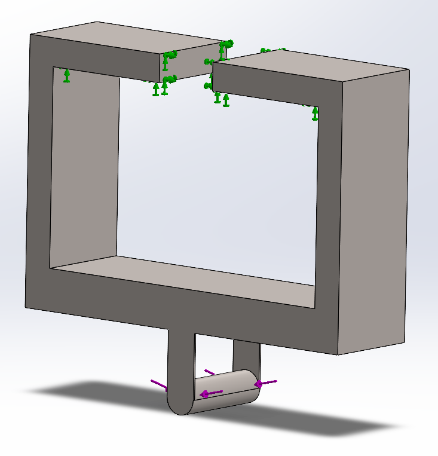
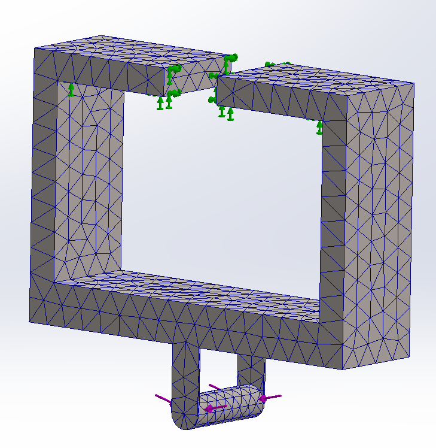
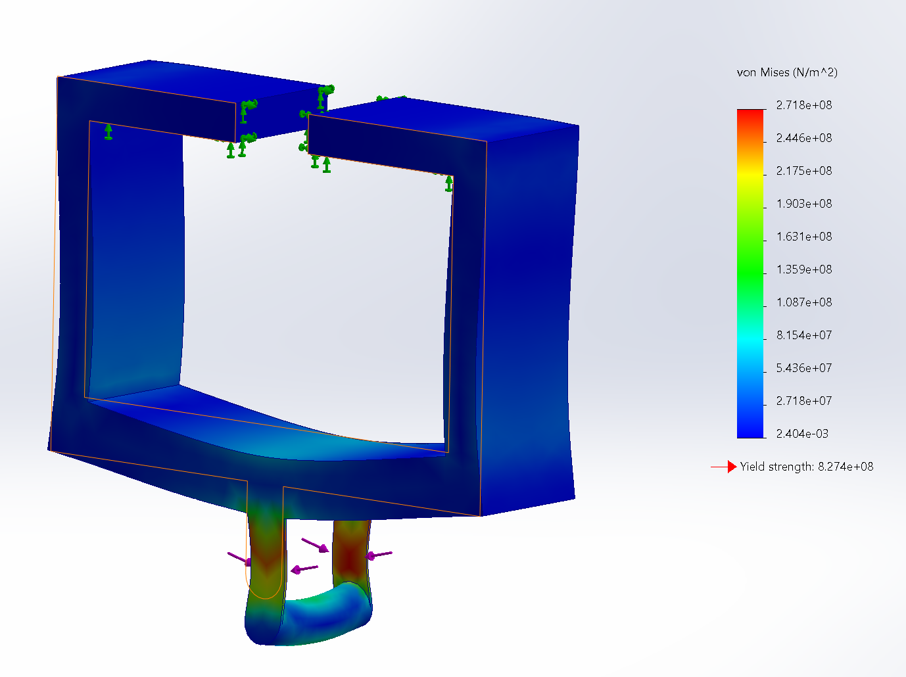
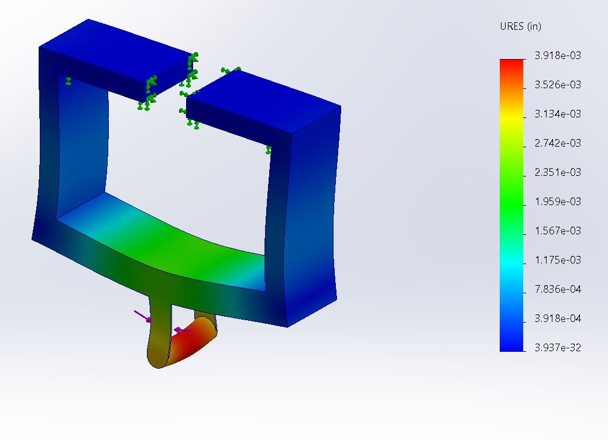
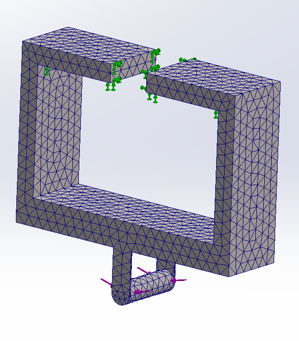
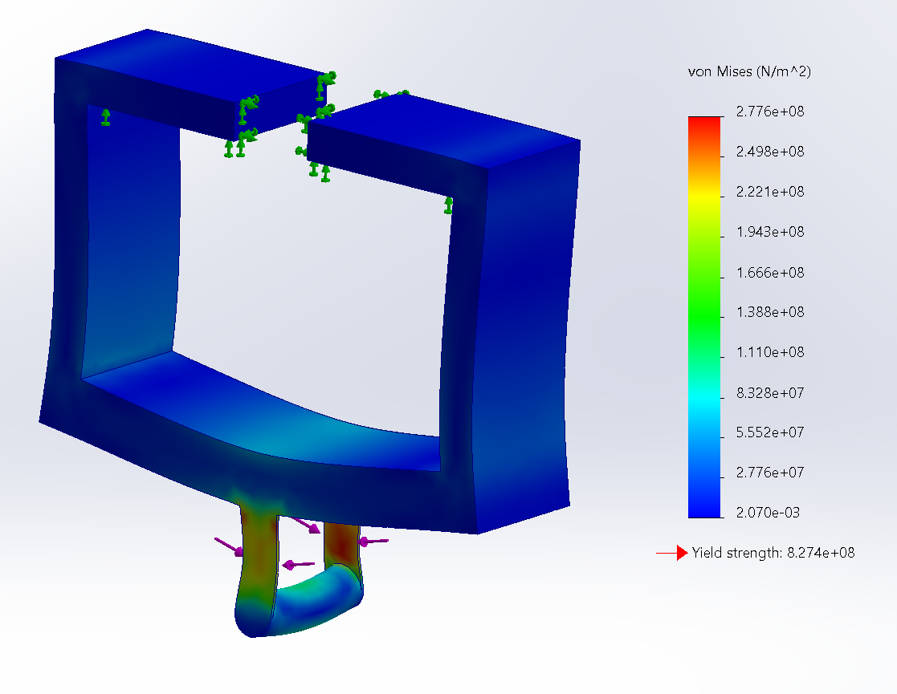
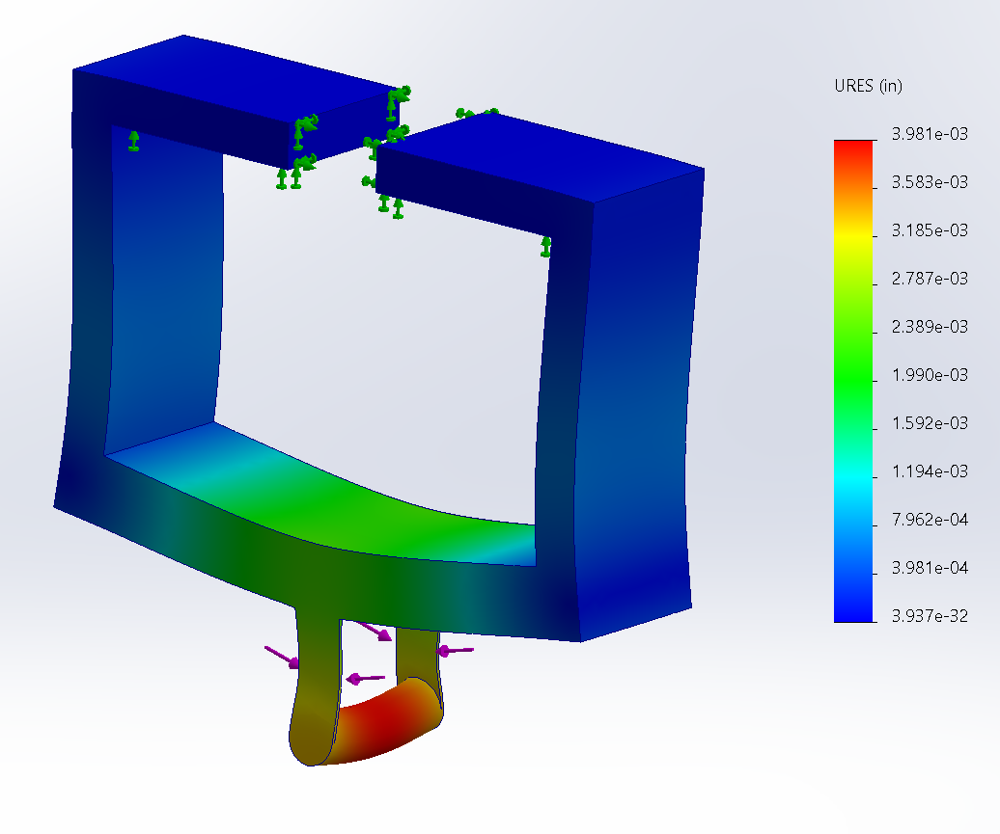
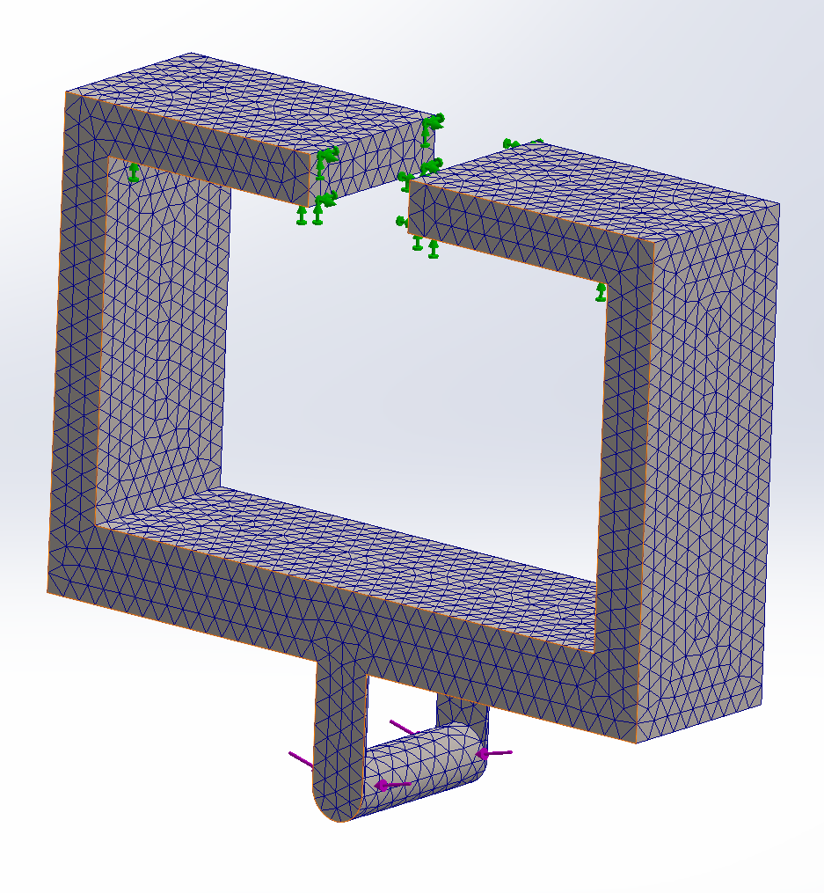
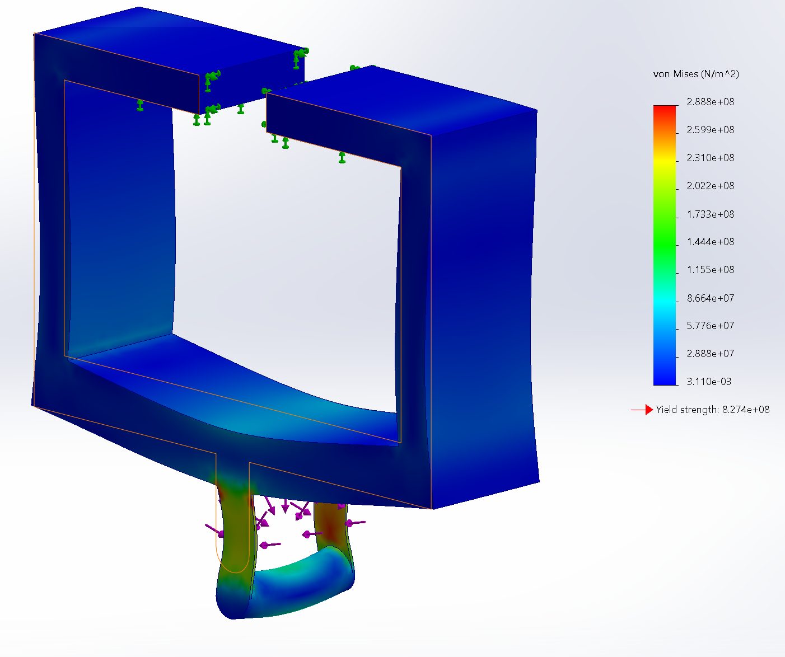
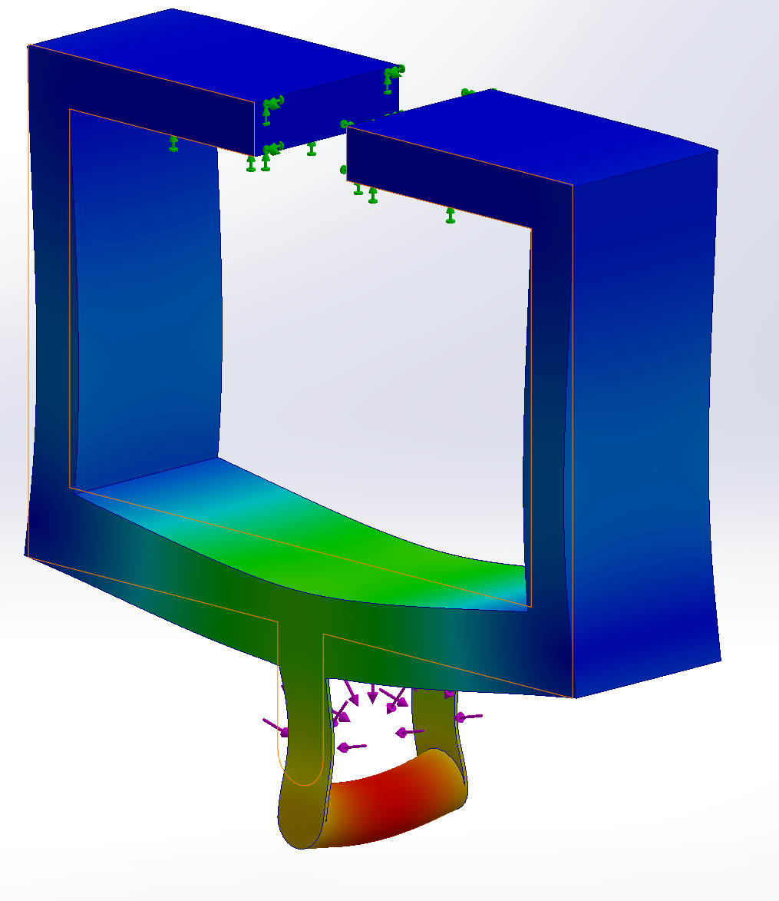

# A7 – FEA on Bracket

## Yield Stress Model

### Design 1 (Outerloop 1)  

This design is the exact same as my Deflection design from A6. The first thing I did for this design was to fixture it so that it can be correctly evaluated using FEA. I fixed the two geometries that would support the most weight in the design. I then added a distributed load on the top half of the cylinder to approximate the loading given by the strap. The image of these fixtures are shown below.

#### Innerloop 1
I created the first mesh and ran the analysis for it.

For this first mesh, The max stress was 3.044e8 N/m2, which gives a safety factor of 3.0441, and a max deflection of 0.003918". This mesh had 3159 elements.

I then created a finer mesh and ran it.

This mesh gave a max stress of 2.78e8 N/m2, which gives a safety factor of 2.98, and a max deflection of 0.003981". This mesh had 7132 elements. For this change, the stress diverged with a difference of 8.67%, and the deflection converged with a difference of 1.60%

I then moved to a third, even finer mesh and ran it.

This mesh gave a max stress of 2.95e8 N/m2, which gives a safety factor of 2.8, and a max deflection of 0.003993". This mesh had 26551 elements. For this change, the stress converged with a difference of 6.12%, and the deflection converged with a difference of 0.30%

### Design 2 (Outerloop 2)

Looking at the design 1 and the areas of high stress, I know I need to add a way to decrease stress where the cylinder holder meets the body of the bracket, as well as a way of making the cylinder holder stiffer laterally so that the cylinder doesn't deflect as much. I also want to lower weight, and I plan to do this by hollowing some of the parts out.  

Here is a screenshot of the improved design.

### Design 3 (Outerloop 3)

